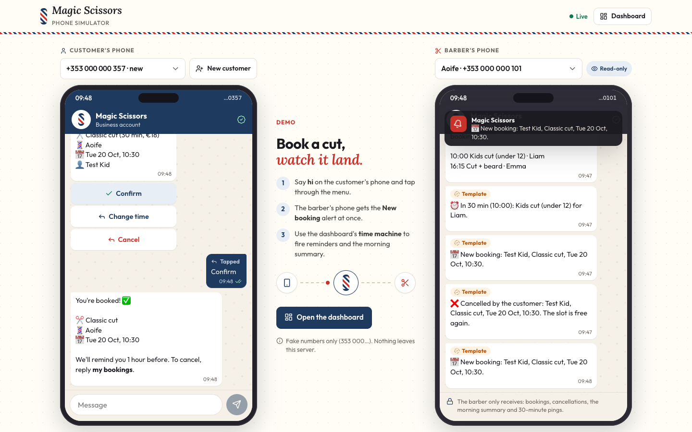
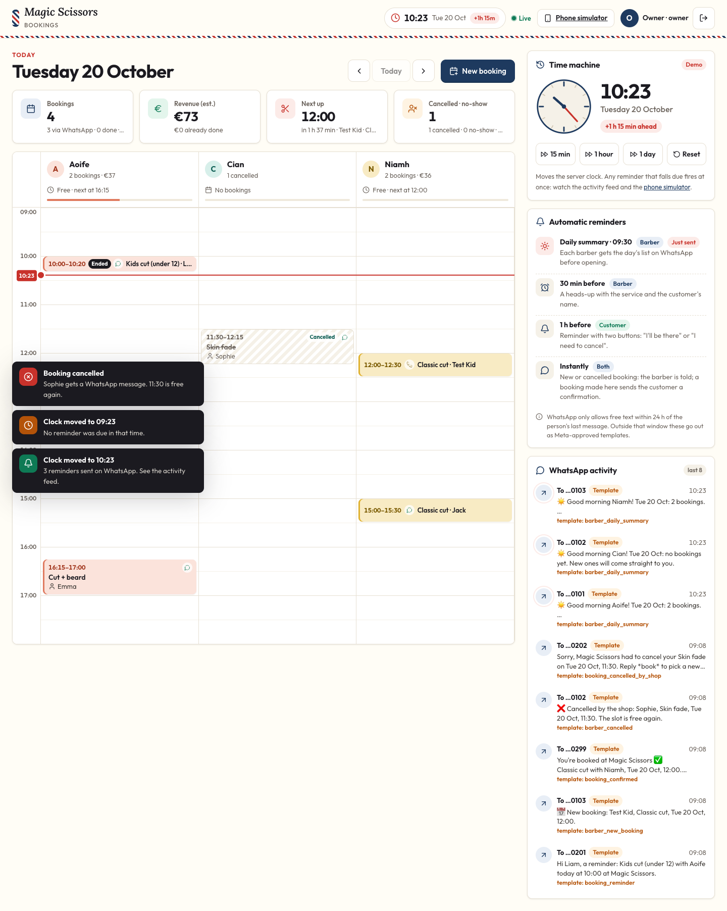

# Barbershop booking over WhatsApp

[](https://github.com/pedroavoc-dev/barbershop-whatsapp-booking/actions/workflows/ci.yml)


Customers book a haircut in a WhatsApp chat. The barber gets the booking on their own WhatsApp straight away, sees the whole day on a live dashboard, and everyone gets reminded at the right time.



**Highlights:** Meta webhook signature check · 24-hour messaging rule enforced in code · no double booking (one write transaction) · reminders de-duplicated by key, retried with backoff · 96-check smoke test with canaries · zero npm dependencies.

Designed for a real kids' barbershop in Ireland, Magic Scissors (name used with permission); not in production yet. **All data in this repo is fictional**: the names are made up and every phone number is in the unused `353000…` range.

## What it does

**Customer, on WhatsApp**
- Taps through *service → barber (or "no preference") → day → time → confirm*. Uses WhatsApp buttons and lists, so there is nothing to type except their name the first time.
- Gets a reminder **1 hour before**, with *I'll be there* and *I need to cancel* buttons.
- Can see and cancel their upcoming bookings at any time ("my bookings").

**Barber, on WhatsApp**
- An alert for every new or cancelled booking, the moment it happens.
- A **daily summary at 09:30** (configurable, must be before 10:00) with the day's list. If the server was down at 09:30, it still goes out late, until noon.
- A ping **30 minutes before** each appointment.

**Barber and owner, on the dashboard**
- Live timeline of the day, one column per barber. It updates without refreshing (Server-Sent Events).
- Book phone calls and walk-ins. The customer still gets a WhatsApp confirmation.
- Cancel (the customer is told), mark done or no-show, see the day's numbers.
- The owner sees every barber and the log of WhatsApp messages. "Sent" in the log means the API accepted the message; delivery receipts are not read yet. A barber sees only their own bookings. Logging out closes the live feed.
- **Demo "time machine"**: moves the server clock forward so you can watch reminders fire without waiting an hour.

## Try it (2 minutes)

Requires Node 24 on macOS or Linux (on Windows, use WSL). No `npm install` needed.

```
git clone https://github.com/pedroavoc-dev/barbershop-whatsapp-booking.git
cd barbershop-whatsapp-booking
npm run seed     # fictional barbers, services, bookings, demo logins
npm run demo     # http://127.0.0.1:8090  (login: owner / demo1234)
```

Then open http://127.0.0.1:8090/phone.html in a second tab. It is a WhatsApp simulator: the customer phone on the left, the barber's phone on the right. Say "hi" and book, then use the dashboard's time machine to watch the reminders arrive.



## How it works

```
WhatsApp ──► /webhook ──► conversation.mjs ──► booking.mjs ──► SQLite
(Meta Cloud API)    (signature check)  (state machine)    (rules, one transaction)
                                                              │
                         reminders.mjs ◄── tick every 30 s ───┤ events
                         (de-duplicated)                       ▼
                                    whatsapp.mjs ──► Meta    dashboard (SSE)
                                    (24 h rule)  └─► simulator (demo)
```

| File | Job |
|---|---|
| `server/booking.mjs` | Free slots (opening hours, lunch breaks, notice, overlap). Create and cancel re-check availability inside one write transaction (`BEGIN IMMEDIATE`), so even several server processes on the same database can't sell a slot twice |
| `server/conversation.mjs` | The chat flow as a state machine; every button carries its own value, so tapping an old message still works |
| `server/reminders.mjs` | Daily summary, 30-min and 1-hour reminders, live alerts; a unique key per reminder, retries with backoff |
| `server/whatsapp.mjs` | Meta Cloud API client, webhook signature check, 24-hour-window rule, simulator transport |
| `server/http.mjs` | Dashboard API, login, CSRF, SSE, webhook endpoint |
| `server/time.mjs` | Injectable clock and Europe/Dublin conversions, including the summer-time switch |

## Decisions worth knowing

- **Meta's 24-hour rule is in the code, not left to luck.** Free-form messages only go out within 24 h of the person's last message. Outside that window (most reminders, and every barber alert) the app sends a pre-approved template, or refuses to send. The templates it needs are listed below.
- **Security.**
  - The webhook rejects anything without a valid `X-Hub-Signature-256` (HMAC with the app secret).
  - Meta's retries are de-duplicated by message id.
  - A customer can only see or cancel their **own** bookings, even if they forge a button id.
  - Dashboard logins use scrypt hashes, an HttpOnly + SameSite=Strict cookie, a CSRF token on every POST, an origin check and a rate limit (per login and per IP).
  - A strict Content-Security-Policy blocks inline scripts; the front end never puts server data into `innerHTML`.
  - The simulator routes don't exist in cloud mode, and the server refuses to start in cloud mode while any login still has the demo password.
- **No AI in the booking path.** Buttons are predictable, cheap and testable. Understanding free text ("can I come Friday after school?") with an LLM is the natural next layer, on top of these same booking rules.
- **Reminders: at-least-once, de-duplicated by key.**
  - Each reminder claims a unique key before sending, so overlapping ticks and restarts don't repeat one that was sent.
  - A failed send is retried after 1, 2, 4 and 8 minutes (about 15 minutes of Meta outage), then given up and left visible as failed. Retries stop once the appointment starts.
  - Honest limit: if the process dies after Meta accepted a message but before it was recorded, that reminder can go out twice. Exactly-once would need Meta's delivery webhooks; a duplicate reminder was judged better than a missing one.
  - A booking made inside the reminder window doesn't get a redundant reminder.
  - A busy day's summary is cut at Meta's 1024-character parameter limit, with "… and N more on the dashboard".

## Tests

```
npm run smoke
```

The smoke test drives the real HTTP server on a throwaway database with a fake clock. It covers 96 checks:
- the full chat booking, including "cancel" typed at the name prompt;
- double booking (a taken or overlapping slot is refused; the next customer isn't offered it);
- opening hours, lunch breaks and days off;
- reminder timing, de-duplication, retry with backoff while Meta is down, and giving up;
- the daily summary, including a 60-booking day that must fit Meta's limit;
- the 24-hour rule;
- forged cancels;
- dashboard permissions, CSRF, and the live feed closing on logout;
- the Meta webhook (signature, re-deliveries, Cloud API payloads) and the simulator being off in cloud mode.

Rules are checked both ways: a positive case, plus a canary where the rule must *not* fire. Some protections were also removed on purpose in a copy of the code to confirm the tests catch it.

Not tested here: two server processes racing on the same database (the transaction design covers it; the test runs one process), session expiry and the login rate limit.

## What I'd do next

1. **LLM layer for free text.** "Can I come Friday after school?" parsed by an LLM that can only call the existing booking functions as tools, so the rules (hours, overlap, 24-hour window) stay in code, not in the prompt.
2. **Delivery receipts.** Read Meta's status webhooks so the log shows delivered and read, not just accepted. This also allows exactly-once reminders.
3. **Pilot with the shop.** Submit the templates to Meta, run behind HTTPS for two weeks, and compare no-shows before and after reminders.
4. **Tests for what isn't covered yet:** two processes racing on one database, session expiry, the login rate limit.
5. **GDPR basics:** a privacy notice in the first message and a retention job for old messages.

## How this was built

Built with Claude Code as a coding agent. `CLAUDE.md` holds the rules the agent must follow on this repo: security invariants, a test for every new rule, no personal data. The design decisions above are mine, and the smoke test is how I check the agent's work.

## Going live (not done here)

1. A WhatsApp Business number on the Meta Cloud API, then `WHATSAPP_MODE=cloud` and the `WA_*` settings in `.env` (see `.env.example`).
2. Create these **utility** templates in WhatsApp Manager. **Drafts, not yet submitted to Meta**: the wording may need changes at review. They are written to Meta's known rules: no variable at the very start or end, enough fixed words around the variables, no line breaks in parameters. The parameter order must stay as below, because the code fills them in that order.

| Name | Body (draft) |
|---|---|
| `booking_reminder` | Hi {{1}}, this is a reminder of your {{2}} with {{3}} today at {{4}}. Let us know if you can still make it. *(quick replies: "I'll be there", "I need to cancel")* |
| `barber_upcoming` | Heads-up: in {{1}} minutes, at {{2}}, you have a {{3}} booked for {{4}}. Check the dashboard for details. |
| `barber_daily_summary` | Good morning {{1}}! Here is your day for {{2}}, with {{3}} bookings so far: {{4}}. Have a great day. |
| `barber_new_booking` | You have a new booking from {{1}} for a {{2}} on {{3}}. It is already on your dashboard. |
| `barber_cancelled` | A booking was cancelled: {{1}}, {{2}} on {{3}}. That time is free again on your dashboard. |
| `booking_confirmed` | Your booking is confirmed: {{1}} with {{2}} on {{3}}. Reply "my bookings" at any time to manage it. |
| `booking_cancelled_by_shop` | We are sorry, but we had to cancel your {{1}} on {{2}}. Reply "book" to choose a new time. |

   Also set `WA_API_VERSION` to a Graph API version Meta currently supports (the default in `config.mjs` is only a starting point).

3. HTTPS in front of the server (`SECURE_COOKIE=1`). Create real logins with `node cli/create_user.mjs <login> [barber_id]`.
4. WhatsApp lists hold at most 10 rows, so the chat shows up to 10 services and 9 barbers (plus "no preference"). A bigger shop needs the lists split into pages.
5. Customer phone numbers are personal data under GDPR. Add a privacy notice to the first message and a retention policy for old messages before real use.
